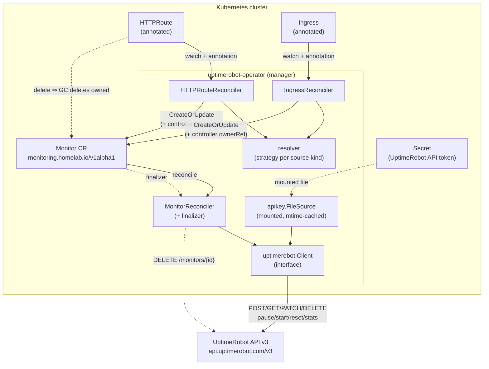
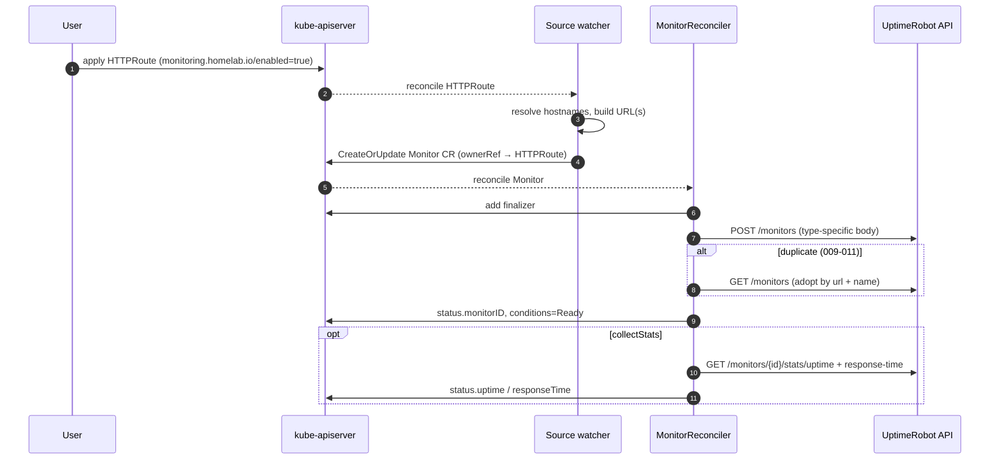
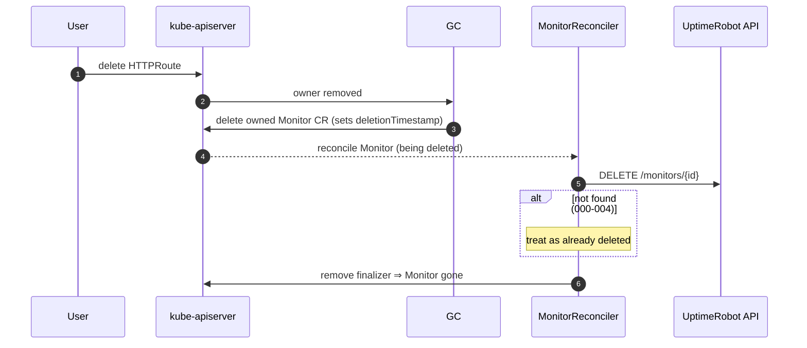

# UptimeRobot Operator — Architecture

The operator creates and deletes [UptimeRobot](https://uptimerobot.com/api/v3/)
monitors for services exposed in a Kubernetes cluster. It is built with
[kubebuilder](https://book.kubebuilder.io/) / controller-runtime and talks to the
UptimeRobot **v3** REST API.

## Components

### Two layers, one source of truth

The **`Monitor` CR is the single source of truth**. There are two layers:

1. **Source watchers** (`HTTPRouteReconciler`, `IngressReconciler`) translate an
   annotated source object into one `Monitor` CR per hostname, each with a
   *controller* `OwnerReference` back to the source. They never call UptimeRobot.
   They also **prune** generated monitors when the annotation is removed or a
   hostname disappears.
2. **`MonitorReconciler`** is the only component that talks to UptimeRobot. It
   owns the create / adopt / update / pause / reset / delete lifecycle and uses a
   finalizer so the external monitor is removed before the CR leaves etcd.

This keeps the integration simple (one API caller), lets users create `Monitor`
CRs directly for full control, and makes deletion cascade reliably.

## Create flow (annotation-driven)

## Delete flow (cascade)

Deleting a `Monitor` CR directly follows the same finalizer path.

## API client resilience

The `uptimerobot` package is transport-only (no controller-runtime imports) and
handles the v3 contract:

- **Auth**: `Authorization: Bearer <token>`, token read from a mounted Secret file.
- **Rate limiting**: a client-side token-bucket limiter (default 10 req/min to
  respect the Free plan) serializes calls so the operator never self-inflicts a 429.
- **Error handling**: responses are parsed into a typed `APIError` carrying the
  stable `code`; callers branch on `code` (falling back to HTTP status for unknown
  codes) via `IsNotFound` / `IsDuplicate` / `IsRateLimited` / `IsTerminal`.
- **429**: surfaced as a rate-limit error carrying `Retry-After`; the reconciler
  requeues after that delay instead of hot-looping.
- **Idempotency**: a create returning `009-011` (duplicate) adopts the existing
  monitor by URL + friendly name; a delete returning `000-004` (not found) is
  treated as success so an out-of-band deletion cannot wedge the finalizer.
- **Type-discriminated body**: `CreateMonitor`/`UpdateMonitor` assemble the exact
  `oneOf` body for the monitor's type (HTTP/KEYWORD/PING/PORT/HEARTBEAT/DNS/API/
  UDP/VISUAL_COMPARISON/THIRD_PARTY_SERVICE); `type` is never sent on update
  (it is immutable server-side).

## Graceful degradation

The HTTPRoute watcher is only started when the Gateway API CRD is present (probed
via the RESTMapper at startup), so the operator runs on clusters without Gateway
API installed. Installing Gateway API later requires an operator restart.
